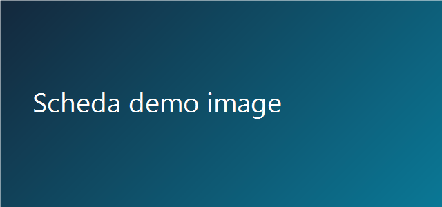

# Scheda 样子演示

一句话：**把 Markdown 读成它该有的子**。零常驻、零联网、冷启动几十毫秒。

## 标题层级

### 三级标题里可以有 `行内代码`

#### 四级标题

正文里混排 **加粗**、*斜体*、~~删除线~~、`inline_code()` 和 [一个链接](https://example.com)。
行内代码应该有一层淡淡的药丸底，链接应该带下划线并用强调色。

> 引用块：左边一条强调色细线，底下一层很淡的染色。
> 第二行继续，用来检查多行引用的行距是否舒服。
>
> > 甚至可以嵌套一层引用。

---

## 列表

- 无序列表第一项，文字稍微长一点，看看换行之后的悬挂缩进对不对，别让第二行跑到圆点下面去。
- 第二项
  - 嵌套一层
    - 再嵌套一层
1. 有序列表一
2. 有序列表二
3. 有序列表三

- [x] 已完成的任务
- [ ] 未完成的任务
- [ ] 第三个

## 代码

```rust
use std::io;

/// 一段带注释的 Rust
fn main() -> io::Result<()> {
    let name = "Scheda";
    let count: usize = 3;
    println!("hello, {}", name);
    Ok(())
}
```

```js
// JS 关键字与字符串
const theme = { name: "极光", dark: true };
function paint(ctx, w, h) {
  return ctx.fillRect(0, 0, w, h);
}
```

## 表格

| 项目 | 状态 | 说明 |
|:-----|:----:|-----:|
| 冷启动 | 完成 | 几十毫秒 |
| 体积 | 进行中 | 目标 ≤ 10MB |
| 万行文档 | 待测 | 不能卡 |

## 图片



## 长段落

这是一个很长的段落，用来检查行高和中文标点的排版。DirectWrite 会自动做 CJK 与拉丁混排的断行，理论上不应该出现标点出现在行首的情况，也不应该把英文单词从中间断开。这里再多写一些字，让这段文字至少占到三到四行，方便观察行距、字距以及两端是否留白一致。再补一句：Scheda 的阅读区最宽 820 逻辑像素，字号 16，行高 1.75，读起来应该很松弛。

结尾。
